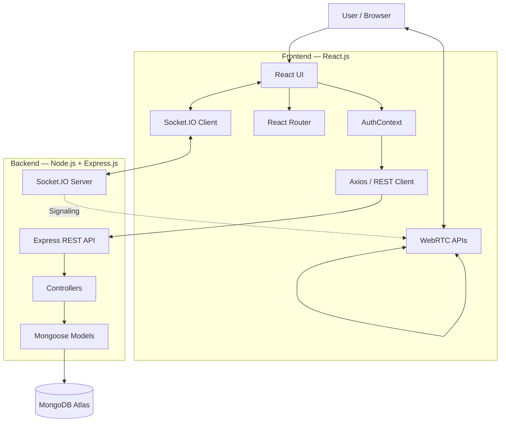
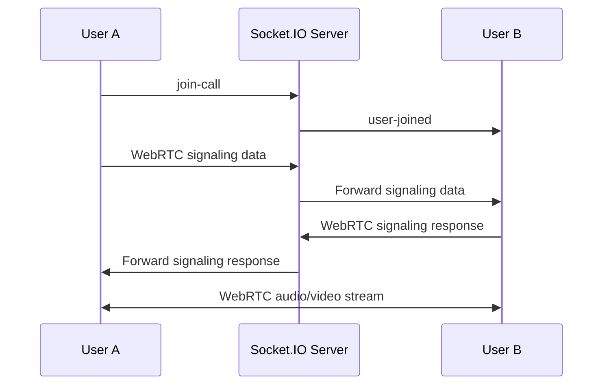

# Zoom Clone — Full-Stack Real-Time Video Conferencing

A full-stack video conferencing web application inspired by Zoom, built with the MERN stack and real-time communication technologies. The application supports user authentication, meeting rooms, audio/video calling, screen sharing, real-time chat, participant presence, and meeting history.

## 🚀 Features

- User registration and login
- Password hashing with bcrypt
- Token-based authentication
- Protected application routes
- Create/join meeting rooms using a meeting URL/code
- Real-time audio and video communication
- Screen sharing
- Mute/unmute microphone
- Enable/disable camera
- Real-time meeting chat
- Participant join/leave notifications
- Meeting history
- Responsive UI using Material UI
- REST API communication between frontend and backend

## 🏗️ Project Architecture



### 🎥 Real-Time Video Call Flow

Socket.IO is used for signaling and meeting events, while WebRTC handles the actual peer-to-peer audio/video communication.



## 🧰 Tech Stack

### Frontend
- React 18
- JavaScript / JSX
- React Router DOM
- Material UI (MUI)
- Axios
- Socket.IO Client
- CSS / CSS Modules
- Browser WebRTC APIs

### Backend
- Node.js
- Express.js
- Socket.IO
- REST APIs
- ES Modules
- CORS

### Database
- MongoDB Atlas
- Mongoose

### Authentication & Security
- bcrypt for password hashing
- Node.js `crypto` for token generation
- Client-side token storage with `localStorage`

### Real-Time Communication
- WebRTC for peer-to-peer audio/video and screen sharing
- Socket.IO for signaling, chat, room events, and participant presence
- Google STUN server for ICE connectivity

### Testing / Tooling
- React Testing Library
- Jest / Create React App test environment
- Nodemon

## 📁 Project Structure

```text
Zoom-main/
├── backend/
│   ├── package.json
│   └── src/
│       ├── app.js
│       ├── controllers/
│       │   ├── socketManager.js
│       │   └── user.controller.js
│       ├── models/
│       │   ├── meeting.model.js
│       │   └── user.model.js
│       └── routes/
│           └── users.routes.js
│
└── frontend/
    ├── package.json
    ├── public/
    └── src/
        ├── App.js
        ├── contexts/
        │   └── AuthContext.jsx
        ├── pages/
        │   ├── VideoMeet.jsx
        │   ├── authentication.jsx
        │   ├── history.jsx
        │   ├── home.jsx
        │   └── landing.jsx
        ├── styles/
        │   └── videoComponent.module.css
        └── utils/
            └── withAuth.jsx
```

## 🔄 Application Flow

```text
User
  │
  ├── Register / Login
  │       ↓
  │   React + Axios
  │       ↓
  │   Express REST API
  │       ↓
  │   MongoDB
  │
  └── Join Meeting
          ↓
      Socket.IO
          ↓
    Signaling Exchange
          ↓
        WebRTC
          ↓
   Audio / Video / Screen
```

## 🧩 Key Modules

### `VideoMeet.jsx`
Core meeting interface responsible for:
- Camera and microphone access
- WebRTC peer connections
- Screen sharing
- Participant handling
- Meeting controls
- Real-time chat

### `socketManager.js`
Handles:
- Meeting rooms
- Socket connections
- WebRTC signaling
- Chat messages
- Participant join/leave events

### `user.controller.js`
Handles:
- Registration
- Login
- Password verification
- Token generation
- Meeting history

### `AuthContext.jsx`
Centralizes:
- Authentication state
- Login/register requests
- Meeting history operations
- API communication


## 🌐 Deployment

The project is structured so the frontend and backend can be deployed separately.

### Backend
Suitable for Node.js hosting platforms such as:
- Render
- Railway
- Other Node.js-compatible platforms

### Frontend
The React application can be deployed on:
- Vercel
- Netlify
- Other static hosting platforms

After backend deployment, update the frontend backend URL in:

```text
frontend/src/environment.js
```

## 🔮 Future Improvements

- JWT-based authentication with refresh tokens
- Redis-backed room/session management
- Persistent chat storage
- TURN server integration for restricted networks
- Automated testing for meeting and signaling flows
- Containerized deployment with Docker
- CI/CD pipeline
- Role-based meeting controls
- Improved scalability for large meetings

